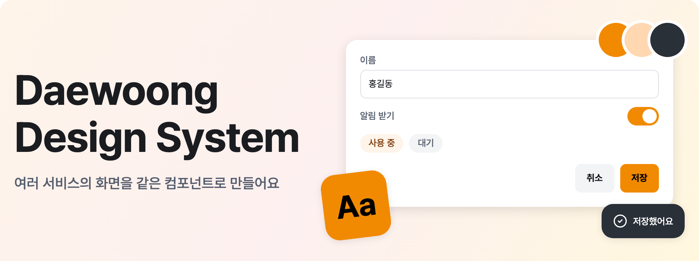

# Daewoong Design System

대웅 서비스들이 공통으로 쓰는 디자인 시스템이다. 패키지로 배포하지 않는다 — 각 서비스는 아래 전달물을 보고
**자기 언어·프레임워크로 구현**하거나, React라면 Storybook의 소스를 복사해 쓴다.

[카탈로그](https://daewoong-axtf.github.io/daewoong-design-system/design/catalog.html) · [AI로 설치하기](#ai로-설치하기) · [직접 설치하기](#직접-설치하기) · [AI용 문서](design/llms.txt)

## 카탈로그

토큰과 컴포넌트를 한 페이지에서 보는 [온라인 카탈로그](https://daewoong-axtf.github.io/daewoong-design-system/design/catalog.html)다. 원본은 [`design/catalog.html`](design/catalog.html)이다.

## AI로 설치하기

프롬프트를 AI에게 주면 프로젝트 환경을 확인해 디자인 시스템을 연결하고 프로젝트 규칙까지 저장한다. GitHub 계정은 필요 없다. AI 없이 적용하려면 [직접 설치하기](#직접-설치하기)를 따른다.

| 프로젝트 | 적용 방식 |
| --- | --- |
| React · Next.js | Tailwind와 shadcn을 쓴다. 없으면 설치하고, 다른 UI 라이브러리를 이미 쓰면 먼저 묻는다 |
| 그 밖의 프론트엔드 (Vue, Svelte 등) | CSS를 연결하고 `dw-*` 클래스를 쓴다. Tailwind를 권장한다 |
| 서버 템플릿 웹 (Java Thymeleaf·JSP, Python Django·Flask 등) | CSS와 `components.js`를 연결하고 `dw-*` 클래스를 쓴다 |
| 웹이 아닌 환경 (Android, iOS, Flutter 등) | `tokens.json`의 값을 가져다 쓰고 컴포넌트는 각 플랫폼에서 구현한다 |

### 설치

1. 아래 **설정 프롬프트 펼치기**를 눌러 프롬프트를 복사한다.
2. 적용할 프로젝트를 Claude Code, Codex, Cursor 같은 AI 도구로 연다.
3. 프롬프트를 붙여 넣는다. AI가 프로젝트 환경을 확인해 맞는 방법으로 연결한다.

AI 도구에는 프로젝트 파일을 고칠 권한과 저장소를 받을 수 있는 네트워크가 필요하다. AI가 프로젝트 파일을 수정하므로 운영 중인 프로젝트는 새 브랜치에서 진행한다.

<!--AI_PROMPT-->
<details>
<summary>설정 프롬프트 펼치기</summary>

```text
이 프로젝트의 기본 디자인 시스템으로 Daewoong Design System을 설정해줘. 파일 가져오기, 프로젝트 연결, AI 프로젝트 규칙 등록까지 끝내서 이후에는 "디자인 시스템 써"라고만 요청해도 쓸 수 있게 해줘.

저장소: https://github.com/daewoong-axtf/daewoong-design-system
가져올 위치(ref): v1.2.0

1. 먼저 프로젝트의 언어, 프레임워크, 스타일 방식, 패키지 관리자, 기존 AI 지침 파일, 수정 중인 파일을 확인해줘. 프로젝트 안에 `docs/design-system.md`가 이미 있으면 다시 가져오지 말고 거기 적힌 버전을 재사용해줘.

2. 저장소를 임시 폴더로 받아줘.
   git clone --depth 1 --branch v1.2.0 https://github.com/daewoong-axtf/daewoong-design-system.git <임시 폴더>
   받은 뒤 `git rev-parse HEAD`로 커밋 값을 적어 둬. 저장소를 받지 못하면 내용을 추측하거나 설치했다고 말하지 말고, 받지 못한 이유를 사용자에게 알려줘.

3. 받은 `design/README.md`, `design/llms.txt`, `design/design.md` 14장을 읽어줘. `design/` 전체는 참고 문서로 `docs/design-reference/`에 복사해줘. 이 폴더는 사용자에게 공개되는 경로에 두지 않는다. 그다음 아래에서 프로젝트에 맞는 경로 하나를 골라줘. 화면 실행에 쓰는 파일은 `fonts/`, `tokens.css`, `components.css`, `js/components.js`, `icons/`다.
   - 서버가 HTML을 만드는 웹(Django, Flask, Spring, Ktor 등): 실행 파일을 정적 파일 경로 아래 `design/`에 복사하고 `fonts/pretendard.css`, `tokens.css`, `components.css`, `js/components.js`를 공통 템플릿에 연결한다. 경로는 프레임워크의 정적 파일 방식을 따른다. 마크업은 `catalog.html`에서 복사한다.
   - React·Next.js: Tailwind CSS v4와 shadcn/ui를 쓴다. 없으면 각 공식 설치 방법으로 설치한다. 단, 이미 다른 UI 라이브러리(MUI, Chakra, Ant Design, styled-components 등)를 쓰고 있으면 설치하기 전에 사용자에게 물어보고, 쓰지 않기로 하면 아래 Vue·Svelte 경로를 따른다. 실행 파일 중 `fonts/`, `icons/`, `tokens.css`, `shadcn.css`를 소스 경로(예: `src/design/`)에 복사하고 14.1절의 순서로 전역 CSS에서 불러온다. shadcn으로 받은 컴포넌트는 14.1절대로 비활성의 `pointer-events-none`을 지우고 메뉴·선택 항목의 `cursor-default`를 `cursor-pointer`로 바꿔 커서가 보이게 한다.
   - Vue·Svelte 등 그 밖의 프론트엔드 프레임워크: 실행 파일 중 `js/components.js`를 뺀 나머지를 번들러가 처리하는 소스 경로(예: `src/design/`)에 복사하고 `fonts/pretendard.css`, `tokens.css`, `components.css`를 전역으로 불러온다. 동작은 그 프레임워크로 구현한다. Tailwind를 권장한다. 이미 쓰고 있으면 화면 배치에 그대로 쓰고, 없으면 설치할지 사용자에게 물어본다.
   - 웹이 아닌 환경(Flutter, Android, iOS, 데스크탑, PDF 등): 참고 문서만 두고, 14.3절대로 `tokens.json`을 그 플랫폼의 색·치수 정의로 옮긴다.

   웹이면 전역 스타일의 페이지 바탕을 `--dw-bg-layer-default`, 글자색을 `--dw-fg-neutral`, 글꼴을 `--dw-font-sans`로, 줄바꿈을 `word-break: keep-all`과 `overflow-wrap: break-word`로 지정해줘. 한글이 음절 중간이 아니라 단어 단위로 줄을 바꾼다. 디자인 시스템은 `body`를 스타일하지 않아서 이 지정이 없으면 다크 모드에서 바탕이 바뀌지 않는다.

4. 아래 원칙을 지켜줘.
   - React·Next.js의 Tailwind·shadcn과 사용자가 승인한 Tailwind 말고는 디자인 시스템을 적용하려고 라이브러리를 새로 설치하지 않는다. 프레임워크를 바꾸거나 주요 의존성을 올리지 않는다.
   - 프로젝트에 같은 경로의 다른 파일이 있으면 덮어쓰지 말고 다른 경로를 쓰거나 사용자에게 물어본다. 관련 없는 파일과 CSS는 유지한다.
   - 화면은 반응형이 기본이다. `375 · 768 · 1024px`에서 깨지지 않게 만든다.
   - 색·간격·모서리·글자는 토큰으로 부른다. 라이트·다크 모드를 모두 유지하고, 기본은 시스템 설정을 따른다.
   - 있는 컴포넌트를 다시 만들지 않는다. 없는 컴포넌트는 토큰으로 프로젝트에서 만든다. 키보드 포커스와 접근성을 유지한다.
   - 기존 화면은 이번 설정에서 다시 디자인하지 않는다. 연결 확인에 필요한 만큼만 바꾸고, 나머지는 사용자가 요청할 때 적용한다.
   - 복사한 문서에 나오는 `pnpm build:*` 명령은 디자인 시스템 저장소 전용이다. 프로젝트에 추가하지 않는다.

5. 이 AI가 실제로 읽는 프로젝트 규칙 파일 하나에 아래 규칙을 병합해줘. 기존 내용은 유지하고, 이미 있는 규칙 파일을 이 AI가 읽지 못할 때만 이 AI가 읽는 파일 하나를 추가해 기존 파일을 참조하게 해줘.
   "사용자가 '디자인 시스템 써', 'Daewoong Design System 써', 'use the design system'이라고 하면 Daewoong Design System을 적용한다. docs/design-system.md를 읽고, docs/design-reference/README.md부터 따른다. 설치된 토큰과 컴포넌트를 재사용하고 프레임워크를 유지한다. 디자인 시스템을 자동으로 업데이트하지 않고 프로젝트의 수정 내용을 덮어쓰지 않는다."

6. `docs/design-system.md`에 저장소 주소, ref, 커밋 값, 고른 경로, 실행 파일을 복사한 위치, 연결한 파일을 기록해줘.

7. 프로젝트에서 쓸 수 있는 타입·빌드·테스트 검사를 실행하고, 화면이 있으면 라이트·다크 모드에서 확인해줘. 임시 폴더는 지워줘. 끝나면 고른 경로, 바꾼 파일, 규칙을 저장한 위치, 검증 결과, 남은 제한을 알려줘. 검증이 실패했으면 완료했다고 말하지 마.

접근 권한, 호환성, 기존 내용 삭제처럼 사용자가 정해야 하는 일만 질문해줘.
```

</details>
<!--/AI_PROMPT-->

### 설치한 뒤

프로젝트 규칙이 저장되므로 이후에는 "디자인 시스템 써"라고만 말하면 된다.

```text
디자인 시스템 써서 설정 화면 만들어줘
```

### AI용 문서

- [문서 목록](design/llms.txt) — AI가 읽을 문서의 색인
- [전체 문서](design/llms-full.txt) — 정본 문서를 한 파일로 합친 판
- [설정 프롬프트 원본](design/ai/setup-prompt.md)

### 버전

설치한 저장소·ref·커밋은 프로젝트의 `docs/design-system.md`에 남는다. 이미 설치한 프로젝트는 자동으로 바뀌지 않는다. 올릴 때는 [업데이트 기록](https://daewoong-axtf.github.io/daewoong-design-system/design/catalog.html#page-history-title)을 확인하고, 프로젝트에서 고친 파일을 덮어쓰지 않는지 비교한다.

## 직접 설치하기

AI 없이 파일을 복사해 연결한다. 패키지 설치는 필요 없다.

### 1. 받기

최신 릴리즈의 [`design.zip`](https://github.com/daewoong-axtf/daewoong-design-system/releases/latest/download/design.zip)을 받아 압축을 푼다. 받은 버전을 프로젝트에 적어 두면 나중에 비교하기 쉽다.

특정 버전을 저장소째 받으려면 태그를 지정한다.

```bash
git clone --depth 1 --branch <태그> https://github.com/daewoong-axtf/daewoong-design-system.git
```

### 2. 복사하기

| 환경 | 복사할 파일 | 위치 |
| --- | --- | --- |
| 서버가 HTML을 만드는 웹 (Django, Flask, Spring 등) | `fonts/` `icons/` `tokens.css` `components.css` `js/components.js` | 정적 파일 경로 아래 `design/` |
| React · Next.js (Tailwind·shadcn) | `fonts/` `icons/` `tokens.css` `shadcn.css` | 소스 경로 아래 `design/` (예: `src/design/`) |
| 그 밖의 프론트엔드 (Vue, Svelte 등) | `fonts/` `icons/` `tokens.css` `components.css` | 소스 경로 아래 `design/` (예: `src/design/`) |
| 웹이 아닌 환경 (Flutter, Android, iOS 등) | `tokens.json` | [14.3절](design/design.md#14-환경별-적용)대로 플랫폼 값으로 옮긴다 |

명세와 가이드를 함께 두려면 `design/` 전체를 공개되지 않는 경로(예: `docs/design-reference/`)에 복사한다.

### 3. 연결하기

서버 템플릿 웹은 공통 템플릿의 `<head>`에 넣는다.

```html
<link rel="stylesheet" href="/design/fonts/pretendard.css">
<link rel="stylesheet" href="/design/tokens.css">
<link rel="stylesheet" href="/design/components.css">
<script src="/design/js/components.js" defer></script>
```

Vue·Svelte 등 그 밖의 프론트엔드 프레임워크는 전역 CSS에서 불러온다. 동작은 그 프레임워크로 구현한다.

```css
@import "./design/fonts/pretendard.css";
@import "./design/tokens.css";
@import "./design/components.css";
```

React·Next.js는 Tailwind와 shadcn을 설치한 뒤 [14.1절](design/design.md#14-환경별-적용)의 불러오는 순서를 따른다.

### 4. 페이지 바탕 지정하기

디자인 시스템은 `body`를 스타일하지 않는다. 지정하지 않으면 다크 모드에서 바탕이 바뀌지 않는다.

```css
body {
  background: var(--dw-bg-layer-default);
  color: var(--dw-fg-neutral);
  font-family: var(--dw-font-sans);
}
```

### 5. 확인하기

버튼을 하나 넣어 모양을 확인하고, 시스템 설정을 바꿔 라이트·다크를 모두 본다.

```html
<button class="dw-button dw-button--brand-solid dw-button--medium" type="button">저장</button>
```

다른 컴포넌트의 마크업은 [`design/catalog.html`](design/catalog.html)에서 복사한다. `pnpm build:*` 명령은 이 저장소 전용이라 프로젝트에 추가하지 않는다.

## 전달물

| 전달물 | 대상 | 내용 |
| --- | --- | --- |
| Figma 링크 | 디자이너·기획자 | 컴포넌트·토큰 라이브러리 _(준비 중)_ |
| [카탈로그](https://daewoong-axtf.github.io/daewoong-design-system/design/catalog.html) | 모두 | 토큰과 컴포넌트를 한 페이지에서 보는 HTML. 언어와 무관하게 마크업을 복사해 쓴다 |
| Storybook 링크 | React 개발자 | 동작하는 React 컴포넌트 모음 _(준비 중)_ |
| [`design/`](design/) | 개발자·AI 에이전트 | 언어 무관 정본 — 토큰, 컴포넌트 명세, 순수 HTML/CSS 레퍼런스, 가이드 |
| [`design/ai/setup-prompt.md`](design/ai/setup-prompt.md) · [`design/llms.txt`](design/llms.txt) | 현업·AI 에이전트 | 복사해서 쓰는 설정 프롬프트와 AI용 문서 |

프로젝트에 붙이는 방법(React·Next.js는 Tailwind·shadcn + `tokens.css` + `shadcn.css`, 그 밖의 웹은 `tokens.css` + `components.css`, 웹이 아닌 곳은 `tokens.json`)은 [`design/design.md` 14장](design/design.md#14-환경별-적용)에 있다.

## 정본 우선순위

`design/tokens.json` > `design/components/<name>.md` > `design/catalog.html`

`tokens.css`는 `tokens.json`에서 생성된다(`pnpm build:tokens`). 충돌하면 `tokens.json`이 이긴다.

## 개발

```bash
pnpm build:tokens   # tokens.json → tokens.css
pnpm build:icons    # lucide-react → design/icons/ (*.svg · sprite.svg · icons.json)
pnpm build:llms     # AI용 문서 → design/llms.txt · llms-full.txt, README 프롬프트
pnpm test               # 토큰·가드 테스트
```

## 라이선스

공개 저장소이며 대웅 서비스를 만드는 데 쓴다. 대웅 로고와 CI는 대웅의 자산이라 다른 용도로 쓸 수 없다.

아이콘은 Lucide(ISC) — [design/icons/LICENSE.md](design/icons/LICENSE.md). 글꼴은 Pretendard(OFL) — [design/fonts/OFL.txt](design/fonts/OFL.txt).

## Storybook

```bash
pnpm storybook          # http://localhost:6006
pnpm test:storybook     # 스토리 play 테스트 + a11y (Chromium)
pnpm shadcn add <name>  # shadcn 원본 컴포넌트 추가 (사내 프록시면 NODE_OPTIONS=--use-system-ca)
```

`src/components/ui/`는 shadcn 원본 그대로다. 색·모서리·그림자는 `src/styles/globals.css`에서 shadcn 변수를 `design/tokens.css`의 `--dw-*` 토큰에 연결해 바꾼다 — 컴포넌트 소스를 고치지 않는다. 정본은 여전히 `design/`이다.
